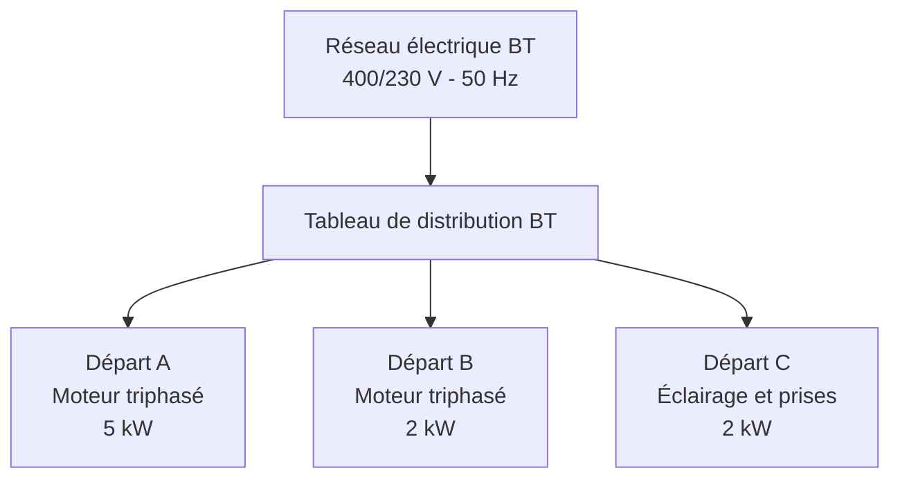

# Étude d'une installation électrique industrielle BT

### Distribution 400/230 V | Dimensionnement des câbles | Protections électriques | Schéma unifilaire

**Projet d'ingénierie électrique — ECAM-EPMI**

**Spécialité :** ISE (Ingénieur en Système Électrique)  
**Réalisé par :** Moustapha IBRAHIM DJAMA et Thomas DHUNARA

[](https://portfolio-eta-ten-t34s52rvq8.vercel.app/)


---

##  Présentation du projet

Ce projet s'inscrit dans le cadre de notre formation d'ingénieur en systèmes électriques à l'ECAM-EPMI.

Il porte sur l'étude technique d'une installation électrique industrielle basse tension destinée à alimenter plusieurs récepteurs, notamment deux moteurs triphasés et un circuit monophasé d'éclairage et de prises de courant.

L'objectif est d'analyser les besoins électriques de l'installation et d'étudier les solutions techniques permettant d'assurer une distribution fiable et adaptée aux charges.

L'étude aborde les principales étapes du dimensionnement électrique :

- L'analyse des caractéristiques des récepteurs.
- L'établissement du bilan de puissance.
- La détermination des courants d'emploi.
- Le dimensionnement des conducteurs électriques.
- L'étude et la coordination des dispositifs de protection.
- La représentation de l'installation par un schéma unifilaire.
- L'exploitation de documents et de données techniques.

Ce travail mobilise les connaissances acquises en électrotechnique, distribution basse tension, calculs électriques et protection des installations.

---

##  Caractéristiques techniques de l'installation

### Données générales

| Paramètre | Valeur |
|---|---|
| Type d'installation | Distribution électrique industrielle BT |
| Tension composée | 400 V |
| Tension simple | 230 V |
| Fréquence | 50 Hz |
| Type de réseau | Triphasé avec neutre |
| Nombre de départs étudiés | 3 |
| Charges principales | Moteurs, éclairage et prises |

### Répartition des charges

| Départ | Récepteur | Puissance | Tension | Longueur |
|---|---|---:|---:|---:|
| A | Moteur industriel triphasé | 5 kW | 400 V | 15 m |
| B | Moteur industriel triphasé | 2 kW | 400 V | 10 m |
| C | Éclairage et prises | 2 kW | 230 V | 20 m |

La somme des puissances indiquées est de **9 kW**. Le dimensionnement réel nécessite de tenir compte des caractéristiques des moteurs, notamment leur rendement, leur facteur de puissance et leurs conditions de fonctionnement.

---

##  Architecture électrique

L'installation est organisée autour d'un tableau principal de distribution basse tension alimentant les différents départs.



Cette représentation fonctionnelle permet d'identifier les principaux circuits et de structurer les étapes du dimensionnement.

---

## Méthodologie de dimensionnement

### 1. Étude du bilan de puissance

La première étape consiste à identifier les récepteurs électriques et leurs caractéristiques nominales.

L'analyse permet d'établir les puissances nécessaires au fonctionnement de l'installation et de déterminer les courants associés.

Pour un récepteur triphasé équilibré :

$$
P = \sqrt{3} \times U \times I \times \cos\varphi
$$

Pour un moteur triphasé, lorsque la puissance donnée correspond à la puissance mécanique utile :

$$
I_b = \frac{P_u}{\sqrt{3} \times U \times \eta \times \cos\varphi}
$$

Avec :

- **P** : puissance électrique active (W).
- **Pu** : puissance mécanique utile (W).
- **U** : tension composée (V).
- **Ib** : courant d'emploi (A).
- **η** : rendement du moteur.
- **cos φ** : facteur de puissance.

Ces relations permettent d'établir les bases du calcul des courants en fonction des caractéristiques des équipements.

### 2. Dimensionnement des câbles électriques

Le choix des sections de conducteurs repose sur plusieurs critères techniques :

- Le courant d'emploi du circuit.
- La longueur de la canalisation.
- Le matériau et l'isolant du conducteur.
- Le mode de pose.
- La température ambiante.
- Les facteurs de correction éventuels.
- La chute de tension admissible.
- Les contraintes thermiques en cas de défaut.

La coordination entre le courant d'emploi, le calibre du dispositif de protection et le courant admissible du câble s'appuie notamment sur :

$$
I_b \leq I_n \leq I_z
$$

Avec :

- **Ib** : courant d'emploi.
- **In** : courant nominal ou de réglage de la protection.
- **Iz** : courant admissible corrigé de la canalisation.

Le choix définitif nécessite également les vérifications liées aux conditions de court-circuit et de protection des personnes.

### 3. Vérification des chutes de tension

La chute de tension constitue un critère essentiel pour garantir des conditions d'alimentation adaptées aux récepteurs.

Elle est exprimée en pourcentage :

$$
\Delta U(\%) = \frac{\Delta U}{U_n} \times 100
$$

La vérification prend en compte la longueur du câble, sa section, le courant transporté et les caractéristiques électriques du circuit.

Une chute de tension excessive peut perturber le fonctionnement des moteurs et dégrader les performances de l'installation.

### 4. Étude des protections électriques

Les dispositifs de protection sont étudiés pour répondre aux contraintes d'exploitation et de sécurité.

L'analyse porte notamment sur :

- La protection contre les surcharges.
- La protection contre les courts-circuits.
- Le choix du calibre des disjoncteurs.
- Le pouvoir de coupure des appareils.
- La coordination entre les dispositifs.
- La protection contre les chocs électriques.

La sélectivité est également prise en compte dans l'étude de l'organisation des protections.

### 5. Schéma unifilaire et documentation

Le schéma unifilaire représente la structure électrique de l'installation et les relations entre les différents équipements.

Il facilite :

- L'identification des départs.
- Le repérage des protections.
- La lecture de l'architecture électrique.
- La compréhension des circuits.
- La préparation du dossier technique.

---

##  Organisation du dépôt

```text
Etude_installation_electrique_BT/
│
├── README.md
│
├── 01_Documents_de_reference_anonymises/
│   ├── Nomenclature_materiel_source_non_verifie.pdf
│   ├── Rapport_technique_source_non_verifie.pdf
│   └── Schema_unifilaire_source_non_verifie.pdf
│
├── 02_Schema_CAO_a_verifier/
│   └── Schema_vectoriel_reconstitue_depuis_PDF.dxf
│
└── A_LIRE_AVANT_REMISE.md
```

### Description des documents

| Document | Description |
|---|---|
| Rapport technique | Informations techniques relatives à l'installation |
| Nomenclature | Identification des équipements électriques |
| Schéma unifilaire | Représentation de l'architecture de distribution |
| Fichier DXF | Support vectoriel exploitable pour l'étude graphique |
| Note d'accompagnement | Précisions sur les documents et leur utilisation |

---

## 🛠️ Environnement technique

L'étude fait appel aux méthodes et outils suivants :

| Domaine | Application |
|---|---|
| Électrotechnique | Analyse des circuits et calculs électriques |
| Dimensionnement BT | Courants, câbles et dispositifs de protection |
| Bureautique technique | Exploitation de tableaux et de documents de calcul |
| DAO / CAO | Lecture et exploitation de schémas électriques |
| Documentation | Organisation et présentation du dossier technique |
| GitHub | Gestion et partage des fichiers du projet |

---

## 📚 Références techniques

L'étude s'appuie sur les principes de conception et de protection des installations électriques basse tension.

Les principales références à considérer sont :

- **IEC 60364** : installations électriques basse tension.
- **NF C 15-100** : exigences applicables aux installations électriques basse tension dans son domaine d'application.
- **Documentation constructeurs** : caractéristiques des câbles et dispositifs de protection.
- **Cours d'électrotechnique et de distribution électrique** : méthodes de calcul et dimensionnement.

L'applicabilité des prescriptions et les éditions normatives doivent être déterminées selon le périmètre de l'installation étudiée.

---

##  Documentation et démarche pédagogique

Ce dépôt rassemble les supports techniques utilisés pour l'analyse de l'installation et l'étude de son dimensionnement.

Les documents de référence proviennent d'un dossier technique antérieur. Ils servent de base de travail pour comprendre l'architecture électrique, examiner les choix de matériels et appliquer les méthodes de calcul étudiées en formation.

Le fichier DXF est une reconstitution vectorielle issue du schéma PDF de référence.

La distinction entre les documents sources et les analyses de l'équipe est conservée afin d'assurer la traçabilité du travail présenté.

---

##  Équipe du projet

**Moustapha IBRAHIM DJAMA**  
Élève-ingénieur — ECAM-EPMI  
Spécialité ISE (Ingénieur en Système Électrique)

🌐 [Portfolio personnel](https://portfolio-eta-ten-t34s52rvq8.vercel.app/)

**Thomas DHUNARA**  
Élève-ingénieur — ECAM-EPMI

---

**ECAM-EPMI | Projet académique en ingénierie électrique**
