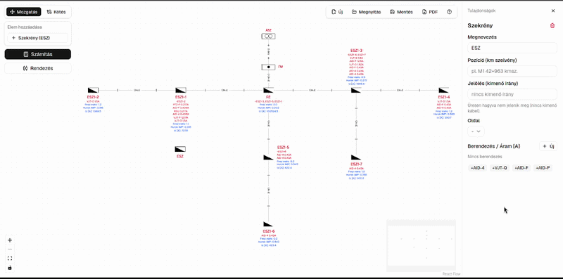
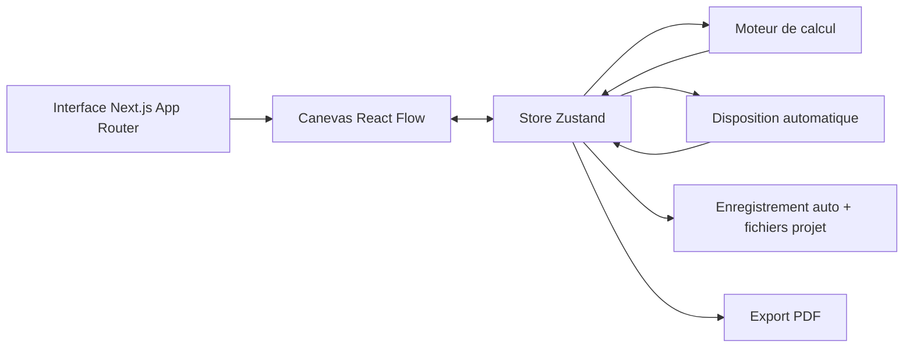

# Outil de Conception et de Dimensionnement de Réseau BT

Un outil d'ingénierie utilisable dans le navigateur, destiné à la conception et au calcul de réseaux de distribution basse tension, au moyen d'un schéma interactif sur canevas.

[Démo en ligne](https://lv-network-design-sizing-tool.vercel.app/) (production, `main`)



> Prototype d'ingénierie à but de démonstration. Les calculs doivent être vérifiés de manière indépendante avant toute utilisation dans des études électriques réelles.

## Déploiement et préproduction

L'application est hébergée sur [Vercel](https://vercel.com), liée au dépôt GitHub.

| Branche   | Environnement | URL |
| --------- | ------------- | --- |
| `main`    | Production    | [lv-network-design-sizing-tool.vercel.app](https://lv-network-design-sizing-tool.vercel.app/) |
| `staging` | Préproduction | URL de prévisualisation pour la branche `staging` (voir ci-dessous) |

### Donner une URL stable à `staging`

1. Pousser sur `staging` (la branche existe déjà sur GitHub).
2. Ouvrir le projet Vercel → **Deployments** et vérifier qu'un déploiement de prévisualisation a bien été lancé pour `staging`.
3. Projet → **Settings** → **Domains** → **Add** :
   - Domaine : `staging-lv-network-design-sizing-tool.vercel.app` (ou votre propre sous-domaine)
   - L'affecter à la branche Git **`staging`**
4. Ensuite, chaque push sur `staging` met à jour cette URL ; `main` reste la production.

Flux de travail : développer sur une branche de fonctionnalité → fusionner dans `staging` pour relecture → fusionner `staging` dans `main` pour la production.

## Présentation

L'Outil de Conception et de Dimensionnement de Réseau BT permet de construire un réseau de câbles souterrains basse tension (0,4 kV) sous forme de schéma nodal interactif.

L'utilisateur peut ajouter une alimentation réseau, un compteur principal, un tableau de distribution principal et des coffrets de distribution en bord de voie, les relier par des câbles, affecter des charges aux équipements, puis calculer :

- La section de câble requise, ainsi qu'une section normalisée recommandée, gradée sur l'ensemble du réseau
- La chute de tension par segment et cumulée, en volts et en pourcentage
- L'impédance de boucle cumulée et le courant de court-circuit à chaque coffret
- Le calibre de fusible maximal suggéré à chaque coffret
- Le courant en aval sur l'ensemble du réseau, éventuellement mis à l'échelle sous forme de courant de dimensionnement avec un coefficient de sécurité paramétrable

Les projets peuvent être disposés automatiquement, enregistrés localement ou exportés dans un fichier, puis imprimés sous forme de schéma PDF.

Le « courant en aval sur l'ensemble du réseau » est le point clé : le moteur ne calcule pas chaque câble isolément. Il construit le graphe connexe, détermine les relations parent/enfant à partir de l'alimentation réseau, et accumule les charges et la chute de tension sur tout le réseau au fur et à mesure qu'il progresse vers l'extérieur.

## Ce qui a été réalisé

- Un éditeur de schéma électrique nodal interactif
- Des nœuds personnalisés et des liaisons par câble construits sur React Flow
- Un moteur de calcul fondé sur les graphes, qui propage les charges électriques et accumule la chute de tension et l'impédance de boucle sur tout le chemin depuis la source
- Un mode « courant de dimensionnement » optionnel, qui met à l'échelle les charges en aval par un coefficient de sécurité paramétrable, reproduisant la méthode du tableur de référence
- Une disposition automatique du réseau complet, avec espacement uniforme et positionnement des étiquettes tenant compte des collisions, pour les nœuds comme pour les câbles
- Les calculs de dimensionnement des câbles, de chute de tension, d'impédance de boucle, de courant de court-circuit et de calibre de fusible maximal
- Une section normalisée recommandée par câble, gradée sur le réseau et affichée sur le schéma
- Des panneaux de propriétés modifiables pour chaque élément et chaque câble du réseau, y compris les noms et désignations personnalisés
- L'enregistrement automatique du projet dans localStorage, pour qu'un rafraîchissement ne fasse jamais perdre le travail
- L'import et l'export au moyen d'un format de projet `.wire.json` personnalisé
- Un export PDF prêt à imprimer, avec légende du schéma et cases à cocher par câble
- Une localisation complète en hongrois, anglais et français
- Un script de vérification qui confronte la sortie du moteur à un tableur Excel de référence
- Un guide `AGENTS.md` permettant aux agents de codage IA (Claude, Cursor, Codex, etc.) d'intervenir dans ce dépôt en toute sécurité

## Architecture



Le canevas (React Flow) n'affiche que ce qui se trouve dans le store Zustand. Chaque action de l'utilisateur (ajouter un élément, tracer un câble, modifier une propriété, lancer Calculer, cliquer sur Disposition auto.) modifie le store, ce qui déclenche le moteur de calcul et réaffiche le schéma. Aucun calcul électrique ne réside dans un composant React.

## Moteur de calcul

La logique de calcul électrique est implémentée indépendamment de l'interface dans `lib/calculations.ts`, avec les fonctions utilitaires de graphe dans `lib/downstream.ts`.

Le moteur traite le réseau comme un graphe enraciné au nœud d'alimentation :

1. Il construit une liste d'adjacence à partir des liaisons par câble.
2. Il effectue un parcours en largeur depuis le nœud d'alimentation pour établir la direction parent/enfant de chaque élément.
3. Il parcourt l'arbre en ordre postfixé, en agrégeant la charge propre de chaque coffret avec tout ce qui se trouve en aval, de sorte que chaque câble transporte le courant total de tout ce qu'il alimente. Si l'option « courant de dimensionnement » du nœud d'alimentation est activée, les totaux en aval sont mis à l'échelle par un coefficient de sécurité modifiable (total des équipements × coefficient / nombre de phases, coefficient par défaut 1,2) au lieu d'utiliser la somme brute des courants. Certains câbles peuvent aussi être exclus de cette mise à l'échelle et continuer à transporter le total brut.
4. Il reparcourt l'arbre en ordre préfixé, en calculant pour chaque câble son dimensionnement, sa chute de tension et son impédance de boucle à partir de ce courant, et en accumulant la chute de tension comme l'impédance de boucle depuis la source vers l'extérieur, câble par câble, sur tout le chemin jusqu'à chaque nœud (et non seulement le dernier câble qui l'alimente).
5. Les nœuds de type coffret sont annotés avec leur propre charge, la charge totale en aval, la chute de tension cumulée (en volts et en pourcentage), l'impédance de boucle cumulée et le courant de court-circuit pour le chemin complet jusqu'à la source, ainsi que le calibre de fusible maximal suggéré à ce point.
6. Enfin, il recommande une section normalisée pour chaque câble (voir ci-dessous).

### Sections recommandées

La section recommandée est optionnelle sur l'étiquette du câble : cocher **Recommandé** dans la liste des valeurs affichées du câble. Elle apparaît en vert lorsque la section actuellement définie est suffisante et en ambre lorsqu'elle est trop faible.

Le moteur résout la recommandation pour l'ensemble du réseau à partir de la topologie, des longueurs et des courants uniquement. Les sections installées ne sont pas une donnée d'entrée : affecter à chaque câble sa section recommandée donne donc un réseau qui reste dans les limites, et relancer le moteur redonne les mêmes valeurs.

Les étapes sont les suivantes :

1. **Plancher thermique** : chaque câble part de la section normalisée immédiatement supérieure à `I / maxCurrentDensity` (par défaut 2 A/mm² sur le nœud d'alimentation ; mettre 0 pour désactiver), ou de la plus petite section normalisée si la densité est désactivée. Il s'agit d'une simple valeur de densité de courant modifiable, et non d'un tableau complet de courant admissible (le type de câble, le mode de pose, le sol et le groupement ne sont pas modélisés).
2. **Chute de tension cumulée** : tant que la chute de tension en volts du chemin d'un coffret dépasse la chute de référence admissible de son câble d'arrivée, on augmente d'un cran de section normalisée le câble du chemin qui apporte le plus de volts. Élargir d'abord le plus gros contributeur préserve le gradage déjà présent dans le réseau, plutôt que de reporter toute la correction sur le dernier câble.
3. **Gradage** : un câble n'est jamais plus fin qu'un câble qu'il alimente ; les sections décroissent donc en s'éloignant de la source et ne remontent jamais. Cette étape est appliquée en dernier, de sorte qu'une artère qui n'avait besoin que d'une petite section pour sa propre chute de tension est tout de même augmentée si elle alimente une branche plus épaisse.

La formule Excel par câble `A = ρ L I / é` (avec `é = 0,75 × U × ε / √3` en triphasé) est conservée sous le nom `requiredCrossSection` et affichée dans le panneau latéral comme section minimale requise. Ce n'est pas à partir d'elle que la recommandation est arrondie, et elle n'apparaît pas sur l'étiquette du câble. `networkRequiredCrossSection` est un besoin continu interne, également non affiché sur l'étiquette.

La recommandation est un conseil, pas une modification automatique : les sections ne changent que par la modification d'un câble.

### Valeurs calculées

Pour chaque segment de câble, le moteur calcule :

- Le courant total transporté (éventuellement sous forme de courant de dimensionnement)
- La section minimale requise du conducteur
- La section normalisée recommandée (gradée sur l'ensemble du réseau)
- La chute de tension en volts
- La chute de tension en pourcentage
- L'impédance de boucle
- Le courant de court-circuit

Les nœuds de type coffret affichent également leur propre charge et la charge en aval dans le panneau latéral. Sur le schéma, la chute de tension cumulée est activée par défaut (volts et pourcentage sur une même ligne) et peut être désactivée ; l'impédance de boucle et le courant de court-circuit sont optionnels par coffret. Le calibre de fusible maximal suggéré est calculé et affiché dans le panneau latéral, pas sur le canevas. Les nombres utilisent la virgule décimale en hongrois et en français, et le point décimal en anglais.

Le moteur prend en charge les systèmes triphasés (400 V) et monophasés (230 V), les formules sous-jacentes et les coefficients de conducteur différant entre les deux.

### Exemples de formules

Chute de tension en triphasé :

```text
ΔU = sqrt(3) x rho x L x I / A
```

Impédance de boucle (aller + retour) :

```text
Z = 2 x rho x L / A
```

Courant de court-circuit :

```text
Icc = 230 V / Z
```

Courant de dimensionnement, lorsque l'option correspondante du nœud d'alimentation est activée :

```text
I_dim = (total brut des équipements x coefficient de sécurité) / nombre de phases
```

Le coefficient de sécurité vaut 1,2 par défaut, mais reste modifiable par projet ; chaque câble peut être marqué pour l'ignorer et transporter le total brut.

Calibre de fusible maximal suggéré :

```text
I_fusible = Icc / 8
```

où `L` est la longueur du câble, `A` la section du conducteur, `I` le courant, et `rho` la résistivité du conducteur en aluminium (seul matériau modélisé par cet outil, conformément au calcul de référence). Le tableur de référence désigne l'impédance de boucle, le courant de court-circuit et le calibre de fusible par Rh, Iz et Bizt.

## Vérification des calculs

Le moteur de calcul est vérifié par rapport aux calculs de référence existants sous Excel : les feuilles `3F` et `1. körzet` de `UHK szamitas pelda.xlsx`, ainsi que `examples/UHK szamitas_Rack_v1.xlsx` (qui corrige le coefficient du courant de dimensionnement et l'accumulation de l'impédance cumulée).

Le banc de vérification dans `scripts/verify-calculations.ts` reconstruit chaque réseau de référence sous forme de nœuds et de liaisons, exécute le moteur de production `runCalculations` (exactement le même chemin de code que l'application), et compare la sortie aux valeurs mises en cache qu'Excel a lui-même calculées, avec des tolérances numériques. Il documente aussi les cellules de synthèse Excel connues comme erronées (en raison d'une colonne décalée), afin que le banc ne poursuive pas un bug du tableur au lieu de celui du moteur.

Les valeurs vérifiées comprennent :

- Le courant en aval, y compris en mode courant de dimensionnement
- La section de câble requise
- La chute de tension en volts et en pourcentage, par câble et cumulée
- L'impédance de boucle, par câble et cumulée
- Le courant de court-circuit
- Le calibre de fusible maximal suggéré

Lancer la vérification :

```bash
pnpm verify:calc
```

## Fonctionnalités

- **Canevas interactif** : déplacer, panoramiquer et zoomer un schéma nodal
- **Éléments de réseau** : alimentation réseau (TR), compteur principal (CC), tableau de distribution principal (TDP) et coffrets (CC). Les projets enregistrés conservent les abréviations hongroises (ÁSZ, FM, FE, ESZ) ; l'interface française affiche les abréviations françaises.
- **Mode Câblage** : relier les éléments par des câbles en changeant de mode, et nommer éventuellement chaque câble
- **Disposition auto.** : redistribuer tout le réseau depuis le nœud d'alimentation, avec un espacement uniforme évitant les collisions
- **Calculs** : dimensionnement des câbles, chute de tension, impédance de boucle cumulée, courant de court-circuit et calibre de fusible maximal sur tout le réseau, avec un mode courant de dimensionnement optionnel
- **Enregistrer et ouvrir** : enregistrer les projets dans un fichier, avec un enregistrement automatique dans localStorage qui survit aux rafraîchissements
- **Export PDF** : exporter le schéma en PDF prêt à imprimer, avec une légende et un contrôle par câble des valeurs calculées affichées
- **Trilingue** : interface complète en hongrois / anglais / français. L'anglais utilise US, MM, MD, FP et Isc ; le hongrois utilise ÁSZ, FM, FE, ESZ et Iz ; le français utilise TR, CC, TDP et Icc. Les décimales suivent la langue active (virgule ou point).
- **Éditeur de propriétés** : sélectionner un élément ou un câble pour inspecter et modifier ses données et ses valeurs calculées, toutes formatées de manière cohérente à 3 décimales avec unités

## Pile technique

| Couche    | Bibliothèque                                                                                          |
| --------- | ----------------------------------------------------------------------------------------------------- |
| Framework | [Next.js 16](https://nextjs.org)                                                                      |
| Canevas   | [React Flow](https://reactflow.dev)                                                                   |
| État      | [Zustand](https://zustand-demo.pmnd.rs)                                                               |
| Interface | [shadcn/ui](https://ui.shadcn.com) + Tailwind CSS                                                     |
| PDF       | [jsPDF](https://github.com/parallax/jsPDF) + [html-to-image](https://github.com/bubkoo/html-to-image) |
| Langage   | TypeScript                                                                                            |

## Choix de conception

### React Flow pour le schéma

React Flow fournit nativement le positionnement des nœuds, les connexions, la navigation au clavier, le panoramique et le zoom, tout en permettant à chaque élément électrique d'être un composant entièrement personnalisé avec son propre symbole et ses propres ports.

### Zustand pour l'état de l'éditeur

Le modèle complet du réseau (nœuds, liaisons, mode du canevas, sélection) est stocké de façon centralisée, de sorte que le canevas, l'éditeur de propriétés, le moteur de calcul, le système d'enregistrement automatique et l'exportateur PDF lisent et écrivent tous les mêmes données de nœuds et de câbles.

### Logique de calcul séparée de l'interface

Les formules électriques et le parcours de graphe résident dans de simples modules TypeScript sous `lib/`, et non dans des composants React. Le moteur est ainsi facile à vérifier, à tester et à réutiliser indépendamment de l'interface, ce que fait précisément `scripts/verify-calculations.ts`.

### Persistance des projets par fichier

Les projets peuvent être exportés et ouverts sous forme de fichier `.wire.json`, sans nécessiter de comptes utilisateur ni de base de données côté serveur. La persistance automatique dans localStorage protège également le travail en cours des rafraîchissements accidentels.

### Dépôt prêt pour les agents

`AGENTS.md` documente les termes du domaine, les commandes et les règles de sécurité (en particulier « ne jamais toucher au moteur de calcul sans relancer `pnpm verify:calc` ») dont un agent de codage IA a besoin pour apporter des modifications correctes et à faible risque à cette base de code.

## Structure du projet

```
app/          # Pages et layout Next.js App Router
components/
  flow/       # Canevas, nœuds personnalisés, liaisons par câble, panneau latéral, barre d'outils
  ui/         # Primitives shadcn/ui
lib/          # Moteur de calcul, parcours de graphe, disposition auto., export PDF,
              # E/S des fichiers projet, i18n
store/        # Stores Zustand (données du réseau, réglages de l'interface)
types/        # Types TypeScript des nœuds et liaisons électriques
scripts/      # Banc de vérification Excel pour le moteur de calcul
examples/     # Fichiers de projet .wire.json d'exemple
docs/         # Ressources du README
```

## Installation locale

```bash
# Installer les dépendances
pnpm install

# Démarrer le serveur de développement
pnpm dev

# Exécuter le moteur de calcul sur la référence Excel
pnpm verify:calc

# Lint
pnpm lint

# Build de production
pnpm build
```

Ouvrir [http://localhost:3000](http://localhost:3000) dans le navigateur.

## Limites et améliorations futures

- L'interface de démonstration est par défaut en français ; un choix automatique selon la langue du navigateur, avec bascule persistante, est une amélioration prévue.
- Le script de vérification est un banc autonome, pas encore intégré à `pnpm test` ni à l'IC. Le porter vers Vitest et ajouter un workflow GitHub Actions est l'étape suivante vers une chaîne entièrement industrialisée.
- Seuls les conducteurs en aluminium sont modélisés, conformément au calcul de référence sur lequel cet outil a été construit.
- La disposition automatique utilise une règle d'espacement en largeur d'abord fixe, plutôt qu'un algorithme général de disposition de graphe ; une passe complète de disposition (par ex. Dagre/ELK) serait utile pour les réseaux très grands ou irréguliers.
